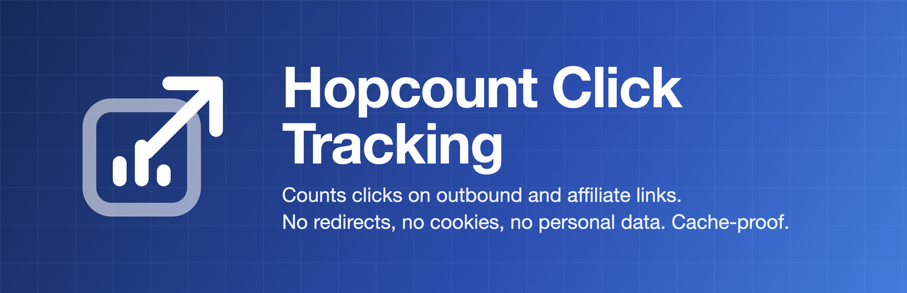
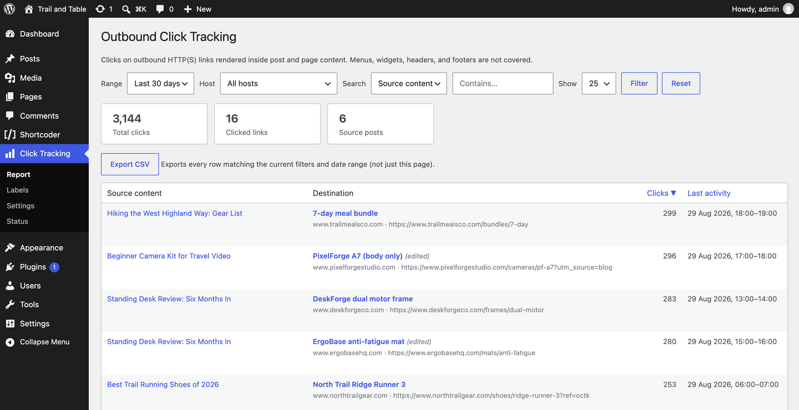
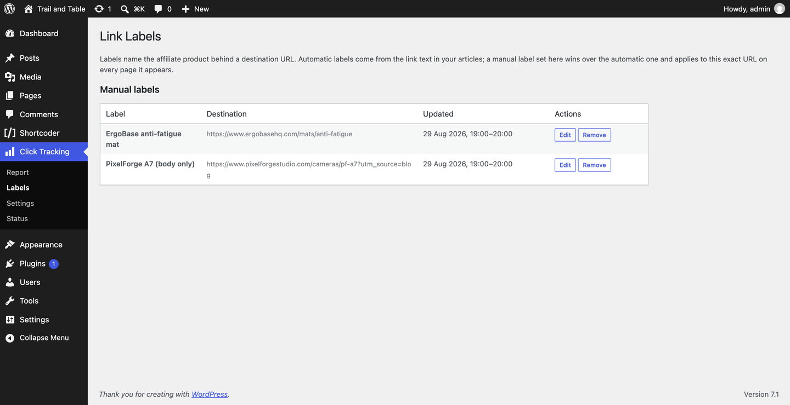
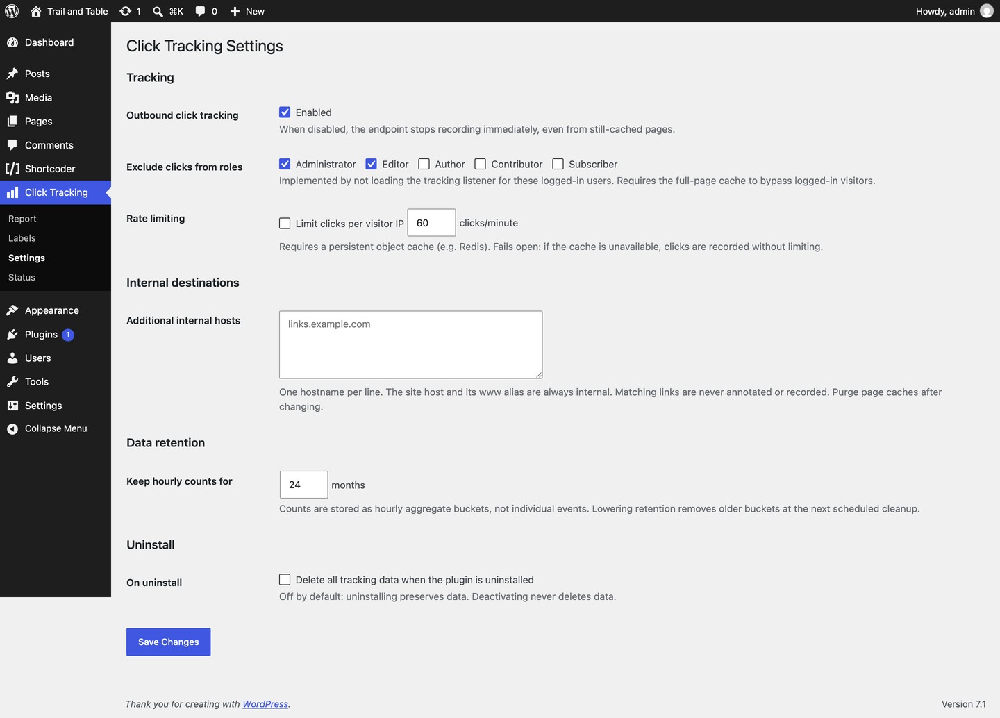
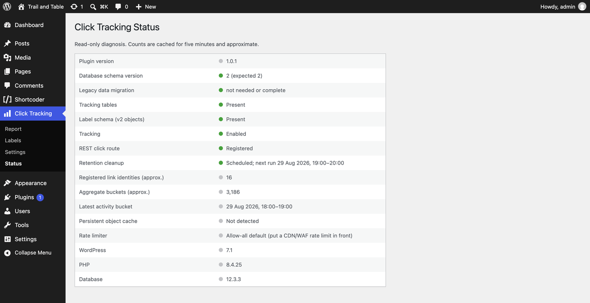
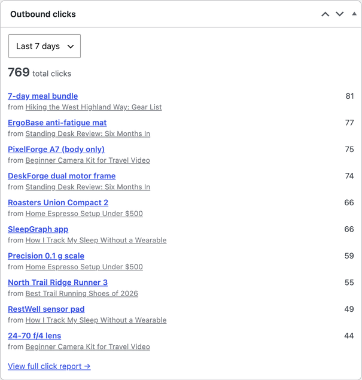

<p align="center">
  
</p>

<p align="center">
  <a href="https://github.com/idkfa2/hopcount-click-tracking/releases/latest"></a>
  
  
  
  <a href="LICENSE"></a>
</p>

<p align="center">
  Counts clicks on outbound and affiliate links in WordPress.<br>
  No redirects, no cookies, no per-click rows, no personal data. Works behind full-page caches.
</p>

---

**Hopcount Click Tracking** records how often visitors click the outbound and affiliate links in your posts and pages and shows the totals in wp-admin. Links keep their real `href` (no cloaking or redirects, which search engines and affiliate programme terms both prefer), and the only thing stored is an hourly count per link.

## Contents

- [Why this plugin](#why-this-plugin)
- [Screenshots](#screenshots)
- [How it works](#how-it-works)
- [Requirements](#requirements)
- [Installation](#installation)
- [Admin screens](#admin-screens)
- [Settings](#settings)
- [Filters](#filters)
- [Data model and privacy](#data-model-and-privacy)
- [Abuse protection](#abuse-protection)
- [FAQ](#faq)
- [Upgrading from the pre-1.0 release](#upgrading-from-the-pre-10-release)
- [Development](#development)
- [Releasing](#releasing)
- [License](#license)

## Why this plugin

Most link-tracking plugins are redirectors: every click goes through your server, and every click becomes a database row. This plugin takes the opposite approach.

| | Hopcount Click Tracking | Redirect / cloaking plugins |
|---|---|---|
| Link `href` | Unchanged, real destination | Rewritten to `/go/...` on your site |
| Per-click storage | None, hourly aggregates only | One row per click, often with IP and user agent |
| Personal data | None | Usually IP, user agent, referrer |
| Cost on cached page views | Zero PHP, zero queries | Redirect hits PHP on every click |
| Frontend payload | About 700 bytes gzipped | Varies |
| Affiliate programme terms | Real destination in the link | Cloaked links are disallowed by some programmes |

There is nothing to anonymise and nothing to add to a privacy policy beyond "aggregate click counts are kept".

The plugin has been submitted to the WordPress.org plugin directory and is awaiting review; until it is listed, install it from the [release zip](#installation).

## Screenshots

**Report**: date range, host filter, search, summary cards and the sortable link table.



| Labels | Settings |
|---|---|
|  |  |

| Status | Dashboard widget |
|---|---|
|  |  |

## How it works

1. **Annotate at render time.** When a single post or page renders, a content filter (priority 50, filterable) adds a server-generated `data-octk-token` to every eligible outbound link. Links to your own site (and any hosts you list as internal) are skipped. Classic editor, Gutenberg, custom HTML and shortcode-emitted links are all covered. Failures never break rendering.
2. **Beacon on activation.** A small deferred listener (about 700 bytes gzipped) watches for click and auxclick (keyboard activation of a link fires a native click event, so it is covered too) and sends `navigator.sendBeacon` (fetch keepalive fallback) to `POST /wp-json/octk/v1/click`.
3. **Count.** The endpoint resolves the token and atomically increments an hourly aggregate. Unknown or malformed tokens are rejected cheaply, and nothing on the public side can write link metadata.

Because tokens live in the rendered HTML, cached pages keep tracking without touching the database. WP Rocket, WP Super Cache, W3 Total Cache, Cloudflare APO and similar all work with no special configuration.

## Requirements

- WordPress 6.5 or newer, single site (multisite is refused at activation)
- PHP 8.0 or newer
- Optional: a persistent object cache (for example Redis) if you enable the built-in rate limiter

## Installation

**From a release zip**

1. Download `hopcount-click-tracking-x.y.z.zip` from the [latest release](https://github.com/idkfa2/hopcount-click-tracking/releases/latest).
2. In wp-admin go to **Plugins > Add New > Upload Plugin**, upload the zip and activate.

**From source**

1. Copy the `hopcount-click-tracking/` folder into `wp-content/plugins/`.
2. Activate **Hopcount Click Tracking**.

Tables and the daily retention cron are created on activation; schema migrations run automatically on load. Visit **Click Tracking > Settings** to review the defaults.

Links are registered the first time a post renders uncached, so if you run a page cache, purge it once after activation to pick up existing content.

## Admin screens

- **Report**: date presets or a custom range, host filter, search by source title (published posts only) or by destination URL/label, summary stat cards, sortable table, per-post "See all links" pin, CSV export (with spreadsheet formula-injection guard).
- **Labels**: manual labels per destination URL, overriding the auto-captured anchor text.
- **Settings** (administrators): master switch, excluded roles, internal hosts, retention window, rate limiter, uninstall behaviour.
- **Status** (administrators): schema version, cron and limiter health, environment.
- **Dashboard widget**: top links for Today / Yesterday / 7 / 30 / 90 days, per-user period preference, 5-minute cache.

## Settings

| Option | Default | Notes |
|---|---|---|
| Outbound click tracking | on | Master switch. When off, no links are annotated, the listener is not loaded and the endpoint returns 403 (including beacons from cached pages). |
| Excluded roles | administrator, editor | Logged-in users with these roles are never tracked and do not receive the listener. |
| Internal hosts | (empty) | Extra hostnames treated as internal, one per line. Your own site host and its www/non-www alias are always internal. |
| Keep hourly counts for | 24 months | 1 to 120. A daily cron prunes older aggregate rows. |
| Rate limiting | off | Per-IP fixed window on the persistent object cache; 60 clicks/minute by default. Fails open when the cache is unavailable. |
| On uninstall | keep data | Opt in to drop the tables and options when the plugin is deleted. |

## Filters

| Filter | Default | Purpose |
|---|---|---|
| `octk_report_capability` | `manage_options` | Who can view the Report, dashboard widget and CSV export. |
| `octk_label_capability` | `manage_options` | Who can manage Labels. |
| `octk_internal_hosts` | option value | Programmatically add internal hosts. |
| `octk_content_filter_priority` | `50` | Priority of the `the_content` annotation filter. |
| `octk_click_allowed` | `true` | Veto a click from the endpoint (custom limiters). |
| `octk_generic_anchor_texts` | built-in list | Anchor texts ("click here", "buy now", ...) not used as auto labels. |
| `octk_public_token_hex` | generated | Override token generation. |
| `octk_migrations` | built-in | Extend the schema migration list. |

Example: let editors and authors see reports and manage labels.

```php
add_filter( 'octk_report_capability', fn() => 'edit_published_posts' );
add_filter( 'octk_label_capability', fn() => 'edit_published_posts' );
```

## Data model and privacy

Three tables under your database prefix:

| Table | Contents |
|---|---|
| `octk_links` | One row per (source post, destination URL): token, destination host, auto-captured label, destination hash. |
| `octk_clicks_hourly` | Click counts per link per UTC hour. |
| `octk_label_overrides` | Manual labels per exact destination URL. |

No IP addresses, user agents, referrers, user IDs or cookies are stored. The optional rate limiter keeps a short-lived per-IP counter in your object cache only and never writes it to the database. Uninstall keeps your data unless you opt in to deletion.

## Abuse protection

The endpoint is public by design (it has to work from cached pages), so anyone can POST to it. The worst a flood can do is inflate counts for links whose tokens the attacker has seen; nothing is stored per request and unknown tokens are rejected with a cheap 4xx. Still, put a limit in front of it. Layers, outermost first:

1. **Rate limit at the edge (recommended).** The built-in limiter is off by default and fails open, so an edge rule is the primary defence.
   - **Cloudflare (free plan includes one rate-limiting rule):** Security > WAF > Rate limiting rules > Create rule. Expression: `URI Path equals /wp-json/octk/v1/click` and `Request Method equals POST`. Characteristic: IP. Rate: 10 requests per 10 seconds. Action: Block for 10 seconds. Real visitors never get near that; a script does within a second.
   - **Other CDNs and WAFs** (Fastly, Bunny, Sucuri, hosting-provider firewalls): the same rule expressed in their terms - match the path and method, key on client IP, block or challenge above roughly 1 request per second.
2. **No CDN? Limit at the web server.** Any server can do this without extra plugins:
   - **nginx:** in the `http` block `limit_req_zone $binary_remote_addr zone=octk:1m rate=1r/s;` then inside the server block `location = /wp-json/octk/v1/click { limit_req zone=octk burst=10 nodelay; try_files $uri /index.php?$args; }`.
   - **Apache:** `mod_ratelimit` cannot count requests, so use `mod_evasive` or `mod_security` with a rule on that path, or ask your host to add one.
   - **Managed hosts** (Kinsta, WP Engine, SiteGround, Cloudways and similar) usually expose a per-path rate limit or a firewall rule in their control panel; the numbers above apply.
3. **Built-in per-IP limiter** (Settings > Rate limiting): a fixed window on your persistent object cache, 60 clicks per minute per IP by default. Use it as a second layer when you have Redis or Memcached; it fails open when the cache is unavailable, which is why it is not the first line.
4. **Always on:** token syntax validation, POST-only, cheap 4xx for unknown tokens, master switch (403s every beacon, including from cached pages), bounded counters, and no writes to link metadata from the public side.

## FAQ

**Does it change my links or redirect visitors?**
No. Links keep their original `href`; the plugin only adds a data attribute at render time.

**What counts as an outbound link?**
Any link in post or page content whose host is not your site (including its www and non-www forms) and not in your internal-hosts list. Links elsewhere in the theme (menus, widgets, footers) are not tracked.

**Which users are tracked?**
Visitors and logged-in users whose role is not in the excluded-roles list (administrators and editors by default).

**Is it GDPR friendly?**
There are no cookies, no personal data and no per-visitor records, so no consent banner is needed for this plugin. Always check with your own adviser for your specific situation.

**Does it support multisite?**
Not yet. Activation on a multisite network is refused.

## Upgrading from 1.0.x

Version 1.1.0 changed only the plugin name and folder: `outbound-click-tracking` became `hopcount-click-tracking`. Nothing in the code prefix, hooks, tables, options or REST route changed, so no data migration runs. Deactivate the old folder, upload the new one, activate it, and delete the old folder. Settings, labels and click counts are all preserved.

## Upgrading from the pre-1.0 release

Version 1.0.0 renamed the plugin (slug, prefix, hooks and REST route) to `octk_`. Existing data is adopted automatically on the first load: tables, options, the retention cron, transients and the dashboard widget preference are renamed in place. Nothing is copied and nothing is deleted.

1. Back up the database.
2. Upload the new `hopcount-click-tracking/` folder next to the old one.
3. Deactivate **Click Tracking** (the old plugin). The migration refuses to run while it is active.
4. Activate **Hopcount Click Tracking**. Check **Click Tracking > Status**: "Legacy data migration" should read "not needed or complete".
5. Purge any page cache, then delete the old plugin folder (its uninstall routine keeps data by default).
6. Update anything that referenced the old names: filters in site code, and any CDN or WAF rule on the old endpoint path (now `/wp-json/octk/v1/click`).

If the migration finds a problem it shows an admin notice with the reason and retries on every page load; tracking and reports stay paused until it completes.

## Development

Requires Docker and Node 20 (`.nvmrc`).

```sh
npm install
npx wp-env start                       # dev site on localhost:8888, tests on 8889
docker run --rm -v "$PWD/tests":/app -w /app composer:2 install
npx wp-env run tests-cli --env-cwd=octk-tests vendor/bin/phpunit
npx wp-env run cli wp plugin check hopcount-click-tracking --categories=plugin_repo
```

Layout: `hopcount-click-tracking/` is the plugin and the only folder that ships; `tests/` is the PHPUnit suite (runs inside the wp-env tests container); `wp-org-assets/` holds the WordPress.org banner, icon and screenshots (SVN `assets/`, not part of the plugin).

## Releasing

Tag `vX.Y.Z` and build the distributable zip from the tag:

```sh
mkdir -p build
git archive --format=zip --prefix=hopcount-click-tracking/ \
  --output=build/hopcount-click-tracking-X.Y.Z.zip vX.Y.Z:hopcount-click-tracking
```

The zip contains a single `hopcount-click-tracking/` root with `hopcount-click-tracking.php` and `readme.txt` directly inside it (dot-files are excluded via `export-ignore`). Attach it to the GitHub release.

## License

GPL-2.0-or-later. See [LICENSE](LICENSE).
